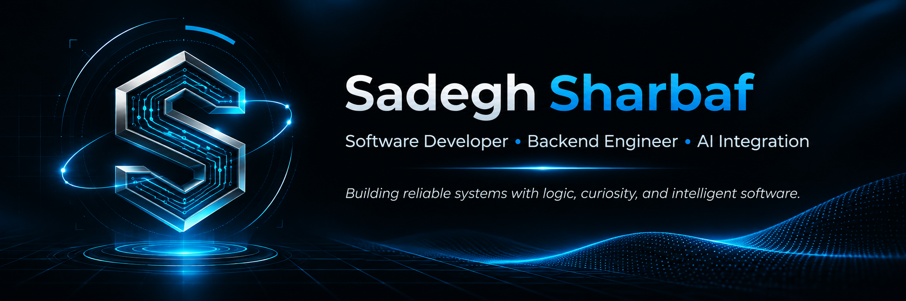

 <div align="center">




<br />


**Building reliable software with logic, curiosity, and intelligent systems.**

<a href="mailto:mohammadsadeghsherbaf@gmail.com"></a>
<a href="https://www.linkedin.com/in/sadeghsharbaf/"></a>
<a href="https://github.com/SadeghSharbaf"></a>

<sub>3+ years in software and application development · Backend · Architecture · Applied AI</sub>

</div>

---

## About

I'm **Sadegh Sharbaf**, a software developer with **3+ years of experience** building software and applications. My main focus is **backend development with Python and Django**, alongside software architecture, system design, and practical integration of AI and large language models.

I enjoy turning complex requirements into clear designs and maintainable systems. I value thoughtful engineering, understandable code, and solutions that solve the right problem—not unnecessary complexity.

## Engineering mindset

- **Understand the problem** — clarify requirements, constraints, and system boundaries before choosing tools.
- **Design with intent** — keep responsibilities clear and interfaces predictable.
- **Build for change** — prefer maintainable components and decisions that can evolve.
- **Validate continuously** — test assumptions, learn from feedback, and improve incrementally.

## Tech stack

<div align="center">

**Languages & Backend**


**Data & Infrastructure**


**Tools & Web Foundations**


</div>

## Areas of interest

- **Backend engineering** — APIs, application logic, data access, and asynchronous workloads.
- **Software architecture** — modularity, maintainability, and clear system boundaries.
- **System design** — reliability, scalability, data flow, and engineering trade-offs.
- **AI & LLM integration** — connecting language models to useful software capabilities.
- **Intelligent automation** — building workflows that reduce repetitive work and support better decisions.

## Currently exploring

Large language models, practical AI integration patterns, tool-using workflows, machine-learning foundations, neural networks, and distributed-systems concepts.

## GitHub activity

<div align="center">


</div>

## Developer mind game

Try each challenge before revealing the answer.

<details>
<summary><strong>01 · Boolean trap</strong> — Beginner</summary>

What does this print?

```python
print(bool([]), bool("0"))
```

<details>
<summary>Reveal answer</summary>

```text
False True
```

An empty list is falsy. A non-empty string is truthy, even when it contains the character `0`.

</details>
</details>

<details>
<summary><strong>02 · Operator mystery</strong> — Intermediate</summary>

What is the result?

```python
print(2 ** 3 ** 2)
```

<details>
<summary>Reveal answer</summary>

```text
512
```

Exponentiation is right-associative: `2 ** (3 ** 2)` equals `512`.

</details>
</details>

<details>
<summary><strong>03 · Decode the signal</strong> — Advanced</summary>

Decode this 8-bit binary value as ASCII:

```text
01010011
```

<details>
<summary>Reveal answer</summary>

```text
S
```

`01010011` is decimal `83`, the ASCII code for uppercase `S`.

</details>
</details>

---

<div align="center">

### Let's build something meaningful.

Open to thoughtful conversations about backend engineering, system design, and applied AI.

<a href="mailto:mohammadsadeghsherbaf@gmail.com"></a>

<br />

<sub>Designed with curiosity · Engineered with intention</sub>

</div>
