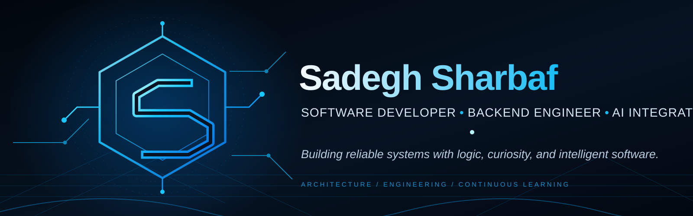

<div align="center">



<br/>

### Building reliable software with logic, curiosity, and intelligent systems.

**Software Developer** · **Backend Engineer** · **AI Integration**

<br/>

<a href="mailto:mohammadsadeghsherbaf@gmail.com">
  
</a>
<a href="https://www.linkedin.com/in/sadeghsharbaf/">
  
</a>
<a href="https://github.com/SadeghSharbaf">
  
</a>

<br/><br/>


</div>

---

## 01 / About Me

I'm **Sadegh Sharbaf**, a software developer with **3+ years of experience** in software and application development.

My core focus is **backend engineering with Python and Django**, supported by a strong interest in **software architecture, system design, and practical AI/LLM integration**. I enjoy turning complex requirements into clear designs, dependable services, and maintainable software.

I care about understanding *why* a system should work a certain way—not just making it work.

## 02 / Engineering Mindset

<table>
  <tr>
    <td width="33%" valign="top">
      <h3>◈ Understand</h3>
      Start with the problem, constraints, and system boundaries before choosing a solution.
    </td>
    <td width="33%" valign="top">
      <h3>◈ Architect</h3>
      Favor clear responsibilities, reliable interfaces, and designs that can evolve.
    </td>
    <td width="33%" valign="top">
      <h3>◈ Improve</h3>
      Validate assumptions, learn continuously, and keep complexity intentional.
    </td>
  </tr>
</table>

## 03 / Tech Stack

<div align="center">

**Backend & Languages**


**Data & Infrastructure**


**Tools & Web Foundations**


</div>

## 04 / Areas of Interest

- **Backend Development** — APIs, application logic, data access, and asynchronous workloads.
- **Software Architecture** — modular design, maintainability, and clear system boundaries.
- **System Design** — scalability, reliability, data flow, and engineering trade-offs.
- **AI & LLM Integration** — connecting language models to useful software capabilities.
- **Intelligent Automation** — designing workflows that reduce repetitive work and improve decisions.

## 05 / Currently Exploring

My current learning focus is on the foundations and practical engineering patterns behind:

- Large Language Models and how they work.
- Integrating AI capabilities into backend applications.
- Intelligent workflows, tool use, and automation.
- Machine learning foundations and neural networks.
- Distributed systems and deeper system-design concepts.

## 06 / GitHub Activity

<div align="center">


<br/>


<br/>


</div>

## 07 / Developer Mind Game

<details>
<summary><strong>LEVEL 01 — The Boolean Trap</strong> · Beginner</summary>

What does this Python expression print?

```python
print(bool([]), bool("0"))
```

<details>
<summary>Reveal answer</summary>

```text
False True
```

An empty list is falsy. A non-empty string is truthy—even when its content is the character `0`.

</details>
</details>

<details>
<summary><strong>LEVEL 02 — Operator Mystery</strong> · Intermediate</summary>

What is the result?

```python
print(2 ** 3 ** 2)
```

<details>
<summary>Reveal answer</summary>

```text
512
```

Exponentiation is right-associative in Python: `2 ** (3 ** 2) = 2 ** 9 = 512`.

</details>
</details>

<details>
<summary><strong>LEVEL 03 — Decode the Signal</strong> · Advanced</summary>

Decode this 8-bit binary value using ASCII:

```text
01010011
```

<details>
<summary>Reveal answer</summary>

```text
S
```

Binary `01010011` is decimal `83`, which maps to uppercase `S` in ASCII.

</details>
</details>

<div align="center">

*Curiosity is the best debugging tool. How many did you solve?*

</div>

---

<div align="center">

### Let's Build Something Meaningful.

Open to thoughtful conversations about backend engineering, system design, and applied AI.

<a href="mailto:mohammadsadeghsherbaf@gmail.com">
  
</a>

<br/><br/>

<sub>Designed with curiosity · Engineered with intention</sub>

</div>
